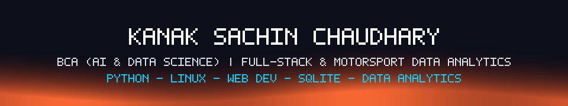

<div align="center">
  
</div>

<div align="center">
  <br /><br />
  
  
  
  <br /><br />
  <a href="https://kanak0091.github.io/Developer-portfolio/"></a>
  <a href="https://www.linkedin.com/in/kanak-chaudhary-bbba52430"></a>
  <a href="https://leetcode.com/u/KC_009"></a>
  <a href="https://www.hackerrank.com/profile/kanakc0207"></a>
  <a href="mailto:2601060001@krmu.edu.in"></a>
</div>

### 🧑‍💻 About Me ✨

```python
kanak = {
    "degree": "BCA in AI & Data Science @ K.R. Mangalam University (2026-29)",
    "career_goal": "Full-Stack Developer & Data Analyst for Oracle Red Bull Racing (F1)",
    "focus": ["Data Handling", "Web Development", "Linux & Shell Scripting", "AI/ML"],
    "tech_stack": ["Python", "HTML/CSS/JS", "SQL (SQLite)", "Bash", "Git", "GitHub"],
    "beyond_code": "Certified Bharatanatyam classical dance teacher"
}
```

### 🛠️ Technical Stack & Tools ⚙️

<div align="center">
  
</div>

<br />

| Category | Technologies |
| :--- | :--- |
| 💻 **Languages** | Python, HTML5, CSS3, JavaScript, Bash / Shell Scripting, SQL (SQLite) |
|🧰 **Developer Tools** | Git, GitHub, VS Code, WSL (Ubuntu), Linux Terminal, Postman, Excel |
| 🧠 **Core Concepts** | Data Cleaning & Validation, EDA, REST APIs, File Systems, Markdown |
| 🏆 **Coding Platforms** | LeetCode (`KC_009`), HackerRank (`kanakc0207`), freeCodeCamp (`kanak0091`) |

### 🗂️ Featured Projects 🚀

| Project | Description | Tech Stack | Link |
| :--- | :--- | :--- | :--- |
| 🌐 **Developer Portfolio** | Dark-themed personal developer portfolio & 6-semester learning roadmap | `HTML` • `CSS` • `GitHub Pages` | [Live Site →](https://kanak0091.github.io/Developer-portfolio/) |
| 🌳 **Yggdrasil Portfolio** (`Yggdrasil-Protfolio`) | Interactive 3D Norse realm & World Tree web portfolio | `JavaScript` • `HTML` • `CSS` | [View Repo →](https://github.com/Kanak0091/Yggdrasil-Protfolio) |
| 📊 **Data Science Capstone** (`Dscapstone`) | Multi-source FinTech loan ingestion, 9-rule schema validation & Streamlit EDA | `Python` • `SQLite` • `Pandas` • `Plotly` | [View Repo →](https://github.com/Kanak0091/Dscapstone) |
| 🐧 **CSE103 Lab Portfolio** (`cse103-lab-LAB3`) | Structured Git collaboration, Bash automation & REST API scripting | `Python` • `Bash` • `Git` • `REST API` | [View Repo →](https://github.com/Kanak0091/cse103-lab-LAB3) |
| 📌 **GitHub Profile Hub** (`Kanak0091`) | Profile README, live contribution streak & repository directory | `Markdown` • `GitHub` | [View Repo →](https://github.com/Kanak0091/Kanak0091) |
| 🛡️ **Mule Account Detection Engine** | Collaborative anomaly detection workflow screening suspicious financial patterns | `Python` • `Data Analytics` | [GitHub Profile →](https://github.com/Kanak0091) |

### 📊 Live GitHub Analytics 🔥

<div align="center">
  
</div>

### 🌱 Currently Working On & Next Milestones 🎯

* 📚 **Academic Track Year 1 BCA** (Python, Web Development, Data Handling, CS Fundamentals, Mathematics, Everyday Communication)
* 🏎️ **[Next Build] Prototype Red Bull Racing F1 Telemetry & Pit-Stop Analytics Dashboard using Python & SQLite** — Mentorship & Events: Guided by Pooja Ma'am, Mamta Ma'am & Sakshi Didi; active in Deep Data Science Hackathons & Industry Workshops.

<div align="center">
  <br />
  
</div>
