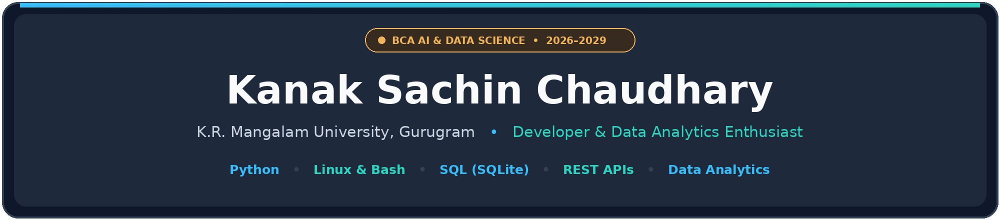
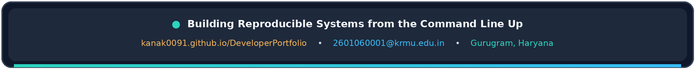

<div align="center">



<br>

[](https://kanak0091.github.io/DeveloperPortfolio/)
[](https://www.linkedin.com/in/kanak-chaudhary-bbba52430)
[](mailto:2601060001@krmu.edu.in)

</div>

---

### About Me

```python
kanak = {
    "degree": "BCA in Artificial Intelligence & Data Science @ K.R. Mangalam University (2026–2029)",
    "location": "Gurugram, Haryana, India",
    "focus": ["Linux & Bash Automation", "Python & SQL (SQLite)", "REST APIs", "Data Analytics"],
    "highlights": ["Deep Data Science Hackathon 3.0", "Generative AI & RAG Workshops"],
    "beyond_code": "Certified Bharatanatyam Classical Dance Teacher (First Division Distinction)"
}
```

---

### Technical Stack & Tools


-38BDF8?style=flat-square&labelColor=1E293B&logo=sqlite&logoColor=white)


| Category | Technologies & Core Competencies |
| :--- | :--- |
| **Languages & Web** | Python, Bash / Shell Scripting, SQL (SQDite), HTML5, CSS3, JavaScript |
| **Developer Tools** | Git, GitHub, Linux Terminal (Ubuntu/WSL), VS Code, Postman, Microsoft Excel |
| **Core Concepts** | File Systems, Process Management, REST APIs & `jq`, Data Analytics, Prompt Engineering, Markdown |

---

### Featured Projects

| Project | Description | Tech Stack | Link |
| :--- | :--- | :--- | :--- |
| **[DeveloperPortfolio](https://github.com/Kanak0091/DeveloperPortfolio)** | End-to-end developer ecosystem repository featuring Linux profiling, Bash automation scripts, REST API extraction, and live GitHub Pages site. | `Linux` `Bash` `Git` `REST API` `HTML/CSS | [Live Site](https://kanak0091.github.io/DeveloperPortfolio/) &bull; [Repo](https://github.com/Kanak0091/DeveloperPortfolio) |
| **[CSE103 Lab (LAB3)](https://github.com/Kanak0091/cse103-lab-LAB3)** | Structured Git collaboration workflows, Linux shell automation, and REST API scripting. | `Python` `Bash` `Git` `REST API` | [View Repo](https://github.com/Kanak0091/cse103-lab-LAB3) |
| **[Data Science Capstone](https://github.com/Kanak0091/Dscapstone)** | Structured dataset analysis using Python and SQLite to uncover patterns and generate reproducible insights. | `Python` `SQLite` `Data Analytics` | [View Repo](https://github.com/Kanak0091/Dscapstone) |
| **Mule Account Detection Engine** | Collaborative Python anomaly detection module screening transaction patterns to flag suspicious mule accounts. | `Python` `Anomaly Detection` | [GitHub Profile](https://github.com/Kanak0091) |

---

### Certifications & Workshops

* **Verified Technical Certifications (Jul – Aug 2026):** Python Fundamentals, Python Logic & Flow, SQLite Fundamentals & Beyond the Basics, AI Prompts Fundamentals, and Excel Fundamentals.
* **Industry-Led Workshops (Sep – Oct 2026):** *Data Engineering, Analytics & Business Intelligence* and *Generative AI & RAG Systems with Prompt Engineering* — K.R. Mangalam University.
* **Hackathons & Achievements:** Deep Data Science Hackathon 3.0 participant (KRMU, Oct 2026); Level 1 Programmer Certification in Computational Thinking (StayQrious Neoschool).

---

<div align="center">


<br>



</div>
